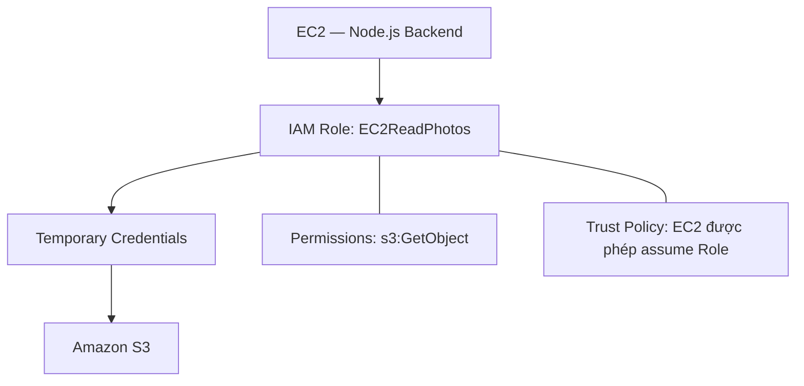
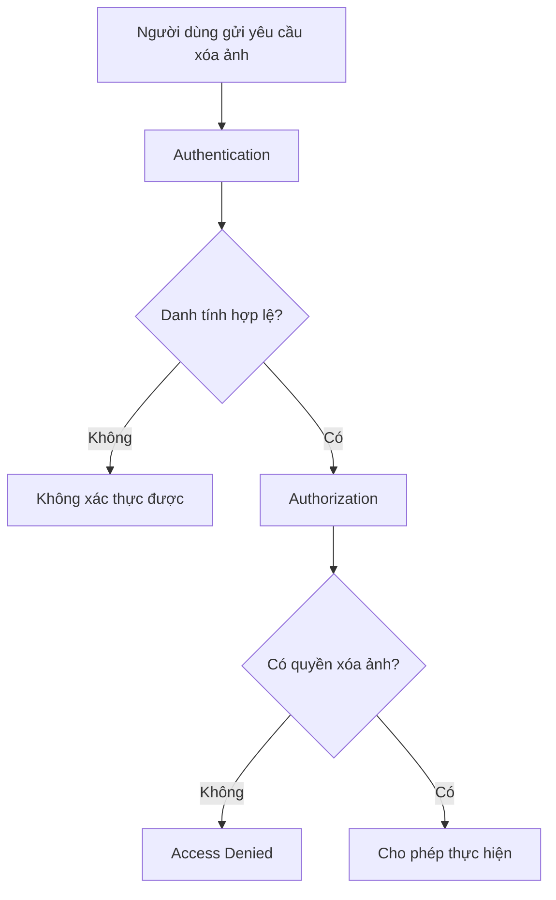
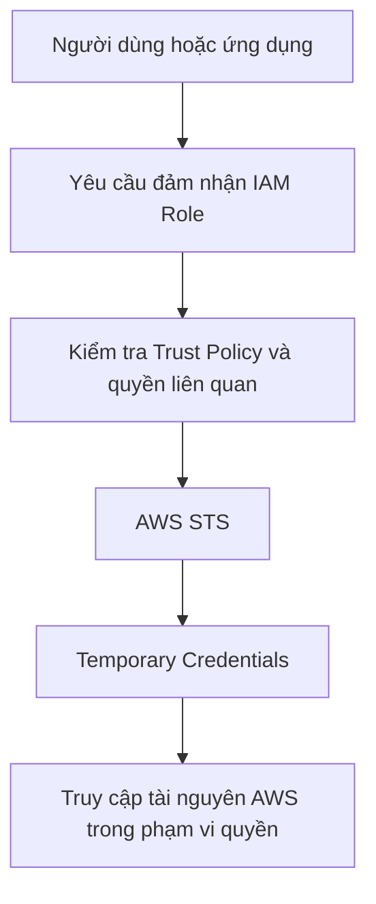
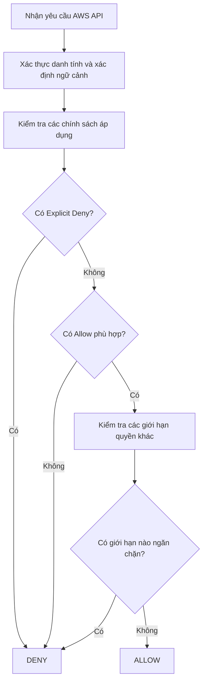
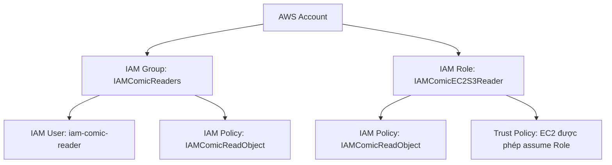

# CHƯƠNG 2 --- AWS IDENTITY & ACCESS MANAGEMENT (IAM)

> **AWS FOR EVERYONE • PHẦN I --- NHẬP MÔN AWS**\
> **Chủ đề:** Quản lý danh tính, tài khoản và quyền truy cập trong AWS.

## Mục tiêu chương

Sau khi học xong chương này, bạn có thể:

-   Hiểu IAM giải quyết vấn đề gì trong AWS.
-   Phân biệt Root User, IAM User, IAM Group và IAM Role.
-   Hiểu cách IAM Policy cấp hoặc từ chối quyền.
-   Phân biệt Identity-based Policy và Resource-based Policy.
-   Hiểu MFA, Access Key, STS và Temporary Credentials.
-   Áp dụng nguyên tắc Least Privilege.
-   Hiểu cách AWS đánh giá một yêu cầu truy cập.
-   Tạo IAM User, Group, Policy và Role bằng AWS Console hoặc AWS CLI.
-   Biết cách xử lý những lỗi IAM thường gặp.

------------------------------------------------------------------------

## Câu chuyện mở đầu: Tòa nhà AWS và những chiếc chìa khóa

Ở Chương 1, chúng ta đã học rằng AWS giống như một khu đất khổng lồ, nơi
bạn có thể thuê máy tính, kho lưu trữ và nhiều dịch vụ khác.

Bây giờ, tưởng tượng bạn đã thuê một tòa nhà trong khu đất đó.

Trong tòa nhà có:

-   Một phòng chứa máy tính (Amazon EC2).
-   Một nhà kho chứa hình ảnh, tài liệu (Amazon S3).
-   Một phòng lưu trữ dữ liệu khách hàng (Amazon RDS).
-   Một phòng điều khiển toàn bộ hệ thống (AWS Management Console).

Ban đầu chỉ có bạn sở hữu tòa nhà, nên mọi thứ rất đơn giản.

Nhưng một ngày, bạn tuyển thêm nhân viên.

Bạn An phụ trách hình ảnh, bạn Bình phụ trách cơ sở dữ liệu, còn bạn
Cường chỉ được xem báo cáo.

Vậy làm thế nào để An chỉ mở được nhà kho, Bình chỉ quản lý được cơ sở
dữ liệu, còn Cường không thể xóa bất kỳ thứ gì?

Không thể đưa cho cả ba người một chiếc chìa khóa mở được mọi căn phòng.

Đó chính là lý do AWS tạo ra **IAM --- Identity and Access Management**.

IAM là hệ thống giúp AWS xác định:

1.  **Bạn là ai?** --- Identity.
2.  **Bạn được làm gì?** --- Access Management.
3.  **Bạn được làm điều đó với tài nguyên nào?** --- Permission.
4.  **Bạn có được phép thực hiện hành động ngay lúc này không?** ---
    Policy Evaluation.

Sau khi hoàn thành chương này, bạn sẽ hiểu cách AWS bảo vệ tài nguyên và
tự xây dựng được một hệ thống phân quyền đơn giản.

------------------------------------------------------------------------

## 2.1. Vì sao AWS cần hệ thống phân quyền?

### 2.1.1. Nếu không có phân quyền thì chuyện gì xảy ra?

Hãy tưởng tượng một trường học có 100 học sinh.

Tất cả học sinh đều được đưa chiếc chìa khóa tổng mở mọi căn phòng trong
trường.

Một học sinh có thể:

-   Vào phòng hiệu trưởng và thay đổi hồ sơ.
-   Mở tủ của giáo viên và lấy đề thi.
-   Xóa thông tin điểm số của học sinh khác.
-   Thậm chí khóa cửa trường khiến mọi người không thể vào.

Đây là một trường học rất nguy hiểm.

Trong AWS cũng vậy. Nếu mọi người đều có quyền cao nhất, một nhân viên
chỉ cần thao tác nhầm cũng có thể làm ngừng hoạt động của cả hệ thống.

Ví dụ, công ty có website bán hàng:

  -----------------------------------------------------------------------
  Người sử dụng           Công việc               Quyền nên có
  ----------------------- ----------------------- -----------------------
  Lập trình viên          Xem log ứng dụng        Đọc CloudWatch Logs

  Nhân viên nội dung      Quản lý hình ảnh        Đọc và tải ảnh lên S3

  Kế toán                 Xem hóa đơn             Chỉ đọc dữ liệu thanh
                                                  toán được phép

  Quản trị viên hệ thống  Quản lý hạ tầng         Những quyền quản trị
                                                  cần thiết
  -----------------------------------------------------------------------

Người lập trình chỉ cần xem lỗi thì không có lý do gì phải được xóa toàn
bộ cơ sở dữ liệu.

### 2.1.2. IAM giải quyết vấn đề như thế nào?

IAM hoạt động giống như người bảo vệ đứng trước mỗi căn phòng.

Mỗi khi có ai muốn làm một việc, AWS kiểm tra xem họ có quyền hay không.

Ví dụ:

  Người dùng   Hành động          Kết quả
  ------------ ------------------ -----------
  An           Xem ảnh trong S3   **Allow**
  An           Xóa ảnh trong S3   **Deny**

AWS không chỉ kiểm tra người đó đã đăng nhập hay chưa. Nó còn kiểm tra
quyền cho từng hành động cụ thể.

### 2.1.3. IAM có mất phí không?

IAM không tính phí riêng cho việc tạo và quản lý người dùng, nhóm hay
vai trò.

Tuy nhiên, những dịch vụ AWS mà người dùng được phép sử dụng vẫn có thể
phát sinh chi phí.

**Ghi nhớ:** IAM không phải nơi chứa dữ liệu hay chạy website. IAM là hệ
thống kiểm soát quyền truy cập vào các tài nguyên AWS.

------------------------------------------------------------------------

## 2.2. Root User là ai? Vì sao không nên sử dụng hằng ngày?

### 2.2.1. Root User giống như chủ sở hữu tòa nhà

Khi bạn đăng ký một tài khoản AWS bằng email, AWS tạo ra danh tính đặc
biệt gọi là **Root User**.

Root User là danh tính có quyền rất cao đối với tài khoản AWS, bao gồm
những thao tác quản lý tài khoản mà người dùng thông thường không thể
thực hiện.

Hãy so sánh:

-   **Root User:** Chủ sở hữu cả tòa nhà.
-   **IAM User:** Một nhân viên được cấp tài khoản.
-   **IAM Role:** Một vai trò có bộ quyền có thể được sử dụng tạm thời.

Root User không phải là người dùng IAM thông thường. Bạn không thể quản
lý Root User giống như một IAM User.

### 2.2.2. Vì sao Root User nguy hiểm?

Giả sử bạn có một tài khoản AWS chứa:

-   3 máy chủ EC2.
-   1 cơ sở dữ liệu RDS.
-   10 S3 buckets chứa dữ liệu.
-   Một hệ thống email SES.

Một kẻ xấu chiếm được quyền đăng nhập Root User có thể gây thiệt hại rất
lớn: thay đổi cấu hình, xóa dữ liệu, tạo thêm tài nguyên tốn tiền hoặc
can thiệp vào bảo mật tài khoản.

Bạn có thể nghĩ:

*"Tôi là chủ tài khoản, sao lại không nên dùng Root User?"*

Bởi vì chiếc chìa khóa quan trọng nhất nên được cất giữ cẩn thận, không
phải mang theo để mở cửa mỗi ngày.

### 2.2.3. Khi nào mới cần Root User?

Một số thao tác đặc biệt yêu cầu Root User, chẳng hạn một số hoạt động
quản lý tài khoản hoặc khôi phục quyền truy cập.

Đối với công việc hằng ngày như tạo EC2, quản lý S3 hay triển khai ứng
dụng, bạn nên sử dụng danh tính quản trị phù hợp thay vì Root User.

### 2.2.4. Bảo vệ Root User như thế nào?

Các nguyên tắc quan trọng:

1.  Sử dụng mật khẩu mạnh và duy nhất.
2.  Bật MFA (xác thực nhiều yếu tố).
3.  Không tạo Access Key cho Root User.
4.  Không chia sẻ tài khoản Root User.
5.  Sử dụng IAM Identity Center hoặc danh tính có quyền phù hợp cho công
    việc thường ngày.

AWS có các yêu cầu và khuyến nghị MFA dành cho Root User; nên ưu tiên
passkey hoặc khóa bảo mật chống phishing khi có thể.

**Ghi nhớ khi thi AWS:** Hễ câu hỏi mô tả việc sử dụng Root User để chạy
ứng dụng hoặc làm việc hằng ngày, đó thường không phải lựa chọn tốt.

------------------------------------------------------------------------

## 2.3. IAM User là gì?

### 2.3.1. Từ Root User đến IAM User

Giả sử bạn mở một cửa hàng và thuê ba nhân viên.

Bạn sẽ không đưa tài khoản ngân hàng chủ cửa hàng cho tất cả nhân viên.

Thay vào đó, mỗi người có một tài khoản riêng.

AWS IAM User cũng có ý nghĩa tương tự.

**IAM User là một danh tính được tạo bên trong tài khoản AWS**, có thể
được cấu hình thông tin đăng nhập và các quyền truy cập riêng.

Ví dụ:

  IAM User           Công việc          Quyền minh họa
  ------------------ ------------------ ---------------------------
  `an-developer`     Lập trình          Đọc S3
  `binh-database`    Quản trị dữ liệu   Quản lý RDS
  `cuong-reporter`   Báo cáo            Chỉ đọc dữ liệu được phép

### 2.3.2. IAM User được phép làm gì khi mới tạo?

Một IAM User mới tạo **mặc định không có quyền thao tác với các tài
nguyên AWS**, trừ khi được cấp quyền bằng những chính sách phù hợp.

Đây là nguyên tắc rất quan trọng.

AWS không nói: "Bạn đã có tài khoản thì muốn làm gì cũng được."

AWS nói: "Bạn có danh tính rồi, nhưng phải được cấp quyền mới làm được."

### 2.3.3. IAM User có những cách đăng nhập nào?

Hai hình thức phổ biến:

  Hình thức          Sử dụng để
  ------------------ ----------------------------------------
  Console password   Đăng nhập AWS Management Console
  Access Key         Gọi AWS API qua CLI, SDK hoặc phần mềm

Không phải IAM User nào cũng cần cả hai.

Ví dụ, một người chỉ dùng giao diện AWS thì không cần Access Key.

### 2.3.4. Có phải ngày nay ai cũng nên tạo IAM User?

Không.

Đây là điểm cần cập nhật so với một số khóa học AWS cũ.

AWS hiện khuyến nghị sử dụng **IAM Identity Center** và đăng nhập liên
kết (federation) cho nhân viên, nhằm sử dụng thông tin xác thực tạm thời
thay cho việc cấp IAM User với thông tin xác thực dài hạn.

IAM User vẫn tồn tại và rất quan trọng để học, duy trì các hệ thống cũ
hoặc xử lý những tình huống đặc biệt. Nhưng với hệ thống mới, đừng mặc
định tạo IAM User cho mọi nhân viên.

------------------------------------------------------------------------

## 2.4. IAM Group là gì?

### 2.4.1. Câu chuyện về lớp học

Giả sử một trường học có 30 học sinh lớp 1A.

Thầy hiệu trưởng muốn cả 30 học sinh được sử dụng thư viện.

Thay vì viết 30 giấy phép riêng, thầy chỉ cần quy định:

"Toàn bộ học sinh lớp 1A được vào thư viện."

Ai thuộc lớp 1A sẽ được hưởng quyền này.

Trong AWS, đó là cách IAM Group hoạt động.

**IAM Group là một tập hợp các IAM Users, giúp quản lý quyền cho nhiều
người cùng lúc.**

### 2.4.2. Ví dụ

Một nhóm có tên `Developers`.

Nhóm này có quyền:

-   Đọc thông tin EC2.
-   Xem CloudWatch Logs.
-   Đọc dữ liệu trong một S3 bucket.

Sau đó bạn đưa ba IAM Users vào nhóm.

Cả ba IAM Users đều nhận những quyền được cấp thông qua nhóm Developers.

Khi có nhân viên mới, bạn chỉ cần thêm người đó vào nhóm.

Khi muốn điều chỉnh quyền của cả phòng lập trình, bạn cập nhật policy
của nhóm thay vì từng người.

### 2.4.3. Những điều cần nhớ về IAM Group

-   Một IAM User có thể thuộc nhiều Group.
-   Group không chứa Group khác.
-   Group dành cho IAM Users, không chứa IAM Roles.
-   IAM Group không phải một danh tính đăng nhập và không tự thực hiện
    các yêu cầu AWS API.

### 2.4.4. Ví dụ một người thuộc hai Group

Bạn An vừa thuộc nhóm `Developers`, vừa thuộc nhóm `S3Readers`.

Quyền từ các nhóm có thể được kết hợp với quyền cấp trực tiếp cho An.

Nhưng nếu có một chính sách `Deny` áp dụng cho một hành động, những
quyền `Allow` khác không thể ghi đè lệnh từ chối rõ ràng đó.

Chúng ta sẽ học điều này ngay sau đây.

------------------------------------------------------------------------

## 2.5. IAM Policy là gì?

### 2.5.1. Nếu IAM User là con người thì Policy là nội quy

Hãy tưởng tượng bạn có một học sinh tên An.

Bạn nói với người bảo vệ:

"An được vào thư viện, nhưng không được vào phòng hiệu trưởng."

Đây là một quy tắc.

Trong AWS, quy tắc về quyền được mô tả bằng **Policy**.

IAM Policy là một tài liệu chứa những điều kiện và hành động được cho
phép hoặc từ chối. Các chính sách IAM thông thường được viết bằng JSON.

### 2.5.2. Ví dụ Policy đầu tiên

Giả sử bạn muốn cho phép một người tải ảnh từ S3.

``` json
{
  "Version": "2012-10-17",
  "Statement": [
    {
      "Effect": "Allow",
      "Action": "s3:GetObject",
      "Resource": "arn:aws:s3:::my-photo-bucket/*"
    }
  ]
}
```

Đừng lo nếu chưa hiểu JSON. Hãy đọc từng phần theo tiếng Việt.

  Thành phần               Nghĩa đơn giản
  ------------------------ ------------------------------------
  `Version`                Phiên bản ngôn ngữ chính sách IAM
  `Statement`              Danh sách các quy tắc
  `Effect: Allow`          Cho phép
  `Action: s3:GetObject`   Được tải hoặc đọc một đối tượng S3
  `Resource`               Tài nguyên mà quy tắc áp dụng

Dòng `Resource` có nghĩa là:

"Quyền này áp dụng đối với các đối tượng nằm trong bucket
`my-photo-bucket`."

Chính sách trên không cho phép tải ảnh mới lên, xóa ảnh, hay tự động
liệt kê tất cả ảnh trong bucket.

Lưu ý: `2012-10-17` là phiên bản cú pháp policy đang được dùng phổ biến,
không phải ngày chính sách được tạo.

### 2.5.3. Policy có các loại nào?

Đối với người mới, hãy bắt đầu bằng ba loại dễ gặp.

**AWS Managed Policy**

Chính sách do AWS tạo và quản lý.

Ví dụ: `AmazonS3ReadOnlyAccess`.

Chính sách này cung cấp các quyền chỉ đọc S3 theo phạm vi được AWS định
nghĩa.

**Customer Managed Policy**

Chính sách do chính bạn tạo và quản lý.

Ví dụ: chỉ cho phép đọc ảnh trong một bucket cụ thể.

**Inline Policy**

Chính sách được gắn trực tiếp vào một IAM User, Group hoặc Role và có
vòng đời gắn với danh tính đó.

Trong nhiều trường hợp, Customer Managed Policy dễ quản lý và tái sử
dụng hơn Inline Policy.

### 2.5.4. Khi nào dùng chính sách có sẵn?

Để học và thử nghiệm, AWS Managed Policy rất thuận tiện.

Nhưng trong production, các chính sách dựng sẵn có thể rộng hơn nhu cầu
của bạn.

Chẳng hạn, ứng dụng chỉ cần đọc một bucket nhưng bạn lại cấp quyền đọc
tất cả bucket thì chưa tuân thủ nguyên tắc phân quyền tối thiểu.

------------------------------------------------------------------------

## 2.6. Hiểu Allow, Deny và Explicit Deny

Đây là một trong những kiến thức quan trọng nhất của AWS IAM, đồng thời
rất hay xuất hiện trong đề thi AWS.

### 2.6.1. Allow là gì?

`Allow` nghĩa là cho phép một hành động.

Ví dụ:

``` json
{
  "Effect": "Allow",
  "Action": "s3:GetObject",
  "Resource": "*"
}
```

Quy tắc này cho phép đọc đối tượng S3 trong phạm vi rộng, nếu không có
chính sách hoặc cơ chế bảo mật khác ngăn chặn.

### 2.6.2. Implicit Deny là gì?

Implicit Deny nghĩa là **từ chối mặc định**.

Ví dụ:

An được phép xem ảnh nhưng chưa từng được cấp quyền xóa ảnh.

Vậy An có xóa ảnh được không?

Không.

AWS mặc định từ chối hành động khi không có quyền cho phép phù hợp.

Bạn không nhất thiết phải viết thêm lệnh `Deny` cho mọi hành động không
mong muốn.

### 2.6.3. Explicit Deny là gì?

Explicit Deny nghĩa là **có một quy tắc viết rõ rằng hành động bị cấm**.

Ví dụ:

``` json
{
  "Effect": "Deny",
  "Action": "s3:DeleteObject",
  "Resource": "*"
}
```

Nếu chính sách này áp dụng cho An, thì hành động xóa đối tượng S3 sẽ bị
từ chối, ngay cả khi một chính sách khác cho phép.

### 2.6.4. Ai thắng khi Allow và Deny xuất hiện cùng lúc?

  -----------------------------------------------------------------------
  Tình huống                          Kết quả
  ----------------------------------- -----------------------------------
  Không có Allow, không có Deny       Từ chối mặc định

  Có Allow, không có Deny và đáp ứng  Cho phép
  các kiểm tra quyền khác             

  Có Explicit Deny                    Từ chối

  Vừa có Allow vừa có Explicit Deny   Từ chối
  -----------------------------------------------------------------------

**Explicit Deny luôn được ưu tiên hơn Allow.**

Đây là quy tắc cơ bản dành cho danh tính IAM. Root User và một số cơ chế
đánh giá quyền phức tạp có những đặc điểm riêng mà chúng ta sẽ phân tích
tại mục 2.15.

**Mẹo ghi nhớ:** `Allow` giống giấy phép đi vào phòng. `Explicit Deny`
giống ổ khóa cấm vào. Có giấy phép mà cửa đã bị khóa thì bạn vẫn không
vào được.

------------------------------------------------------------------------

## 2.7. IAM Role là gì? Khác IAM User ở đâu?

### 2.7.1. Câu chuyện chiếc thẻ nhân viên tạm thời

Tưởng tượng một bệnh viện có một phòng chứa thuốc.

Bác sĩ An có tài khoản nhân viên riêng. Tuy nhiên, khi làm nhiệm vụ kiểm
tra thuốc, bác sĩ cần một bộ quyền chuyên biệt.

Bệnh viện cấp cho bác sĩ một thẻ công tác có thời hạn.

Trong thời gian sử dụng thẻ, bác sĩ được thực hiện những việc phù hợp
với vai trò đó.

Khi nhiệm vụ kết thúc, quyền sử dụng thẻ cũng kết thúc.

IAM Role hoạt động theo ý tưởng tương tự.

**IAM Role là một danh tính AWS có những quyền được xác định sẵn, có thể
được một danh tính hoặc dịch vụ đáng tin cậy đảm nhận (assume) để lấy
thông tin xác thực tạm thời.**

### 2.7.2. Khác biệt giữa IAM User và IAM Role

  -----------------------------------------------------------------------
  Đặc điểm                IAM User                IAM Role
  ----------------------- ----------------------- -----------------------
  Là danh tính AWS        Có                      Có

  Có thể có mật khẩu      Có                      Không
  Console                                         

  Có thể có Access Key    Có                      Không
  dài hạn                                         

  Có thể được dùng bởi    Không phải cách khuyến  Có
  dịch vụ AWS             nghị                    

  Thông tin xác thực      Có thể dài hạn          Tạm thời

  Cách sử dụng            Đăng nhập hoặc sử dụng  Assume Role
                          credentials của user    
  -----------------------------------------------------------------------

Hãy ghi nhớ bằng hai câu:

-   **IAM User:** Đây là một danh tính tồn tại lâu dài trong AWS.
-   **IAM Role:** Đây là một danh tính có bộ quyền được người dùng hoặc
    dịch vụ đảm nhận tạm thời.

### 2.7.3. Ai có thể sử dụng IAM Role?

Có nhiều đối tượng:

-   Một EC2 instance cần truy cập S3.
-   Một Lambda function cần đọc DynamoDB.
-   Một ứng dụng chạy trên ECS cần truy cập SQS.
-   Một người dùng được liên kết từ hệ thống đăng nhập của tổ chức.
-   Một người hoặc ứng dụng từ tài khoản AWS khác, nếu được thiết lập
    quan hệ tin cậy phù hợp.

### 2.7.4. Hai phần quan trọng của IAM Role

Một IAM Role thường có hai thành phần mà người mới rất hay nhầm.

**Trust Policy --- Ai được nhận vai trò?**

Ví dụ: EC2 được phép đảm nhận vai trò này.

**Permissions Policy --- Vai trò được làm gì?**

Ví dụ: sau khi nhận vai trò, ứng dụng được đọc hình ảnh trên S3.

Một IAM Role không tự động có quyền chỉ vì được tạo ra. Bạn vẫn phải cấp
đúng permissions policy.

Đồng thời, một người hoặc dịch vụ không thể mặc nhiên assume mọi role;
họ phải đáp ứng chính sách tin cậy và các điều kiện cấp quyền liên quan.

------------------------------------------------------------------------

## 2.8. Ví dụ: EC2 cần đọc file từ S3

Đây là ví dụ rất quan trọng đối với lập trình viên.

### 2.8.1. Bài toán thực tế

Bạn xây dựng một website trên AWS.

Website chạy bằng Node.js trên EC2.

Hình ảnh sản phẩm nằm trong Amazon S3.

Khi người dùng mở trang sản phẩm, backend cần lấy thông tin hoặc tải
hình ảnh từ S3.

Câu hỏi:

**EC2 phải chứng minh với S3 rằng nó có quyền đọc ảnh bằng cách nào?**

### 2.8.2. Cách không nên làm: Lưu Access Key trong ứng dụng

Một người mới học có thể tạo IAM User, lấy Access Key rồi đặt trong file
`.env`.

Ví dụ minh họa cho cách làm không nên dùng trên EC2:

``` env
AWS_ACCESS_KEY_ID=AKIA_EXAMPLE
AWS_SECRET_ACCESS_KEY=EXAMPLE_SECRET
```

Nếu những thông tin này bị lộ qua GitHub, log hoặc một sự cố bảo mật, kẻ
tấn công có thể lợi dụng chúng để gọi AWS API.

Bạn còn phải tự xử lý việc thay đổi khóa khi cần.

### 2.8.3. Cách nên làm: Gắn IAM Role vào EC2

Thay vì đưa khóa bí mật dài hạn vào ứng dụng, bạn tạo một IAM Role với
quyền đọc S3.

Sau đó gắn Role này vào EC2 thông qua một thành phần gọi là **Instance
Profile**.



### 2.8.4. Quy trình thực sự diễn ra

1.  Administrator tạo một IAM Role.
2.  Trust Policy cho phép dịch vụ EC2 đảm nhận Role.
3.  Permissions Policy cho phép Role đọc đối tượng trong S3 bucket.
4.  Administrator gắn Role vào EC2 thông qua Instance Profile.
5.  Ứng dụng trên EC2 sử dụng AWS SDK để lấy thông tin xác thực tạm
    thời.
6.  AWS kiểm tra quyền và cho phép hoặc từ chối yêu cầu đọc ảnh.

Thông tin xác thực của Role có thể được lấy thông qua EC2 Instance
Metadata Service (IMDS). AWS SDK được cấu hình đúng có thể tự động lấy
và làm mới thông tin này.

Bạn không cần tự tạo Access Key dài hạn cho ứng dụng.

### 2.8.5. Ví dụ policy cho Role

``` json
{
  "Version": "2012-10-17",
  "Statement": [
    {
      "Effect": "Allow",
      "Action": "s3:GetObject",
      "Resource": "arn:aws:s3:::my-photo-bucket/*"
    }
  ]
}
```

Role này chỉ được cấp hành động đọc đối tượng trong bucket chỉ định, chứ
không được phép xóa hoặc tải đối tượng mới lên chỉ nhờ policy này.

### 2.8.6. Ví dụ AWS SDK với TypeScript

Cài đặt:

``` bash
npm install @aws-sdk/client-s3
```

Tạo file `read-photo.ts`:

``` typescript
import { S3Client, GetObjectCommand } from "@aws-sdk/client-s3";

const s3 = new S3Client({
  region: "ap-southeast-1"
});

async function readPhoto() {
  const result = await s3.send(
    new GetObjectCommand({
      Bucket: "my-photo-bucket",
      Key: "photos/cat.jpg"
    })
  );

  const content = await result.Body?.transformToByteArray();

  console.log("Photo size:", content?.length);
}

readPhoto().catch(console.error);
```

Điều đặc biệt là không có:

``` typescript
accessKeyId: "..."
secretAccessKey: "..."
```

Khi chạy trên EC2 có IAM Role được cấu hình đúng, SDK v3 có thể sử dụng
cơ chế tìm kiếm thông tin xác thực mặc định (Default Credential Provider
Chain) để truy cập AWS.

Khi chạy trên máy cá nhân, SDK có thể dùng credentials từ phiên đăng
nhập IAM Identity Center hoặc profile AWS đã cấu hình.

**Điều kiện để chạy thành công:** Bucket và file phải thực sự tồn tại,
Region phải phù hợp và các cơ chế bảo mật liên quan đều phải cho phép
truy cập.

**Ghi nhớ khi thi:** Ứng dụng chạy trên EC2 cần truy cập AWS S3? Hãy
nghĩ đến IAM Role cho EC2 trước khi nghĩ đến Access Key.

------------------------------------------------------------------------

## 2.9. Authentication và Authorization khác nhau thế nào?

Hai thuật ngữ này rất dễ nhầm.

### 2.9.1. Authentication --- Xác thực danh tính

Authentication trả lời câu hỏi:

**"Bạn là ai?"**

Tưởng tượng bạn đi vào trường học.

Người bảo vệ yêu cầu bạn xuất trình thẻ học sinh.

Nếu thẻ hợp lệ và xác thực thành công, trường học nhận ra danh tính của
bạn.

AWS cũng phải xác thực danh tính của bên gửi yêu cầu trong những tình
huống cần xác thực.

### 2.9.2. Authorization --- Kiểm tra quyền

Authorization trả lời câu hỏi:

**"Bạn được phép làm gì?"**

Dù bạn là học sinh của trường, bạn cũng không được tự ý vào phòng hiệu
trưởng.

Tương tự, dù một IAM User đã đăng nhập thành công, người đó chưa chắc đã
có quyền xóa một S3 bucket.

### 2.9.3. So sánh

              Authentication         Authorization
  ----------- ---------------------- ----------------------------
  Câu hỏi     Bạn là ai?             Bạn được làm gì?
  Ví dụ       Đăng nhập thành công   Được đọc S3
  Liên quan   Credentials, MFA       Policy, permissions
  Ý nghĩa     Xác thực danh tính     Đánh giá quyền của yêu cầu



Cần nhớ rằng xác thực thành công không đồng nghĩa với có quyền thực hiện
mọi hành động.

------------------------------------------------------------------------

## 2.10. MFA và Access Key

### 2.10.1. MFA là gì?

MFA viết tắt của Multi-Factor Authentication --- xác thực nhiều yếu tố.

Ví dụ:

Bạn muốn mở một chiếc két sắt.

Chiếc két yêu cầu hai thứ:

-   Một mật khẩu.
-   Một bằng chứng xác thực bổ sung, chẳng hạn mã từ ứng dụng xác thực
    hoặc khóa bảo mật.

Kẻ trộm chỉ biết mật khẩu vẫn không dễ dàng mở két.

AWS sử dụng MFA để tăng mức độ bảo vệ khi đăng nhập và trong những tình
huống bảo mật khác.

### 2.10.2. MFA có những hình thức nào?

  Phương thức             Ví dụ
  ----------------------- ------------------------------------------------------
  Virtual authenticator   Ứng dụng tạo mã TOTP
  Passkey                 Thông tin xác thực dùng cơ chế mật mã khóa công khai
  Security key            Khóa bảo mật phần cứng
  Hardware TOTP token     Thiết bị tạo mã xác thực

AWS khuyến nghị các hình thức chống phishing như passkey hoặc security
key khi có thể.

### 2.10.3. Access Key là gì?

Access Key là một hình thức thông tin xác thực dùng để ký yêu cầu AWS
API.

Đối với Access Key dài hạn của IAM User, nó bao gồm:

-   **Access Key ID:** Mã định danh của khóa.
-   **Secret Access Key:** Khóa bí mật dùng để tạo chữ ký xác thực.

Có thể tưởng tượng Access Key ID giống như mã nhận diện chiếc chìa khóa,
còn Secret Access Key là phần bí mật chứng minh bạn sở hữu chiếc chìa
khóa đó.

Hai thành phần cần được bảo vệ phù hợp; đặc biệt, Secret Access Key
tuyệt đối không được công khai.

### 2.10.4. Vì sao Access Key dài hạn có rủi ro?

Access Key không tự hết hạn theo một phiên đăng nhập ngắn như
credentials của IAM Role.

Nếu làm lộ khóa mà không phát hiện và vô hiệu hóa, kẻ tấn công có thể
tiếp tục lợi dụng khóa để thực hiện những hành động mà IAM User được
phép.

Vì vậy, khi có thể, AWS khuyến nghị sử dụng credentials tạm thời thay vì
khóa dài hạn.

### 2.10.5. MFA khác Access Key ra sao?

MFA là cơ chế tăng cường xác thực.

Access Key là một loại thông tin xác thực cho các yêu cầu lập trình.

Bật MFA cho một IAM User không có nghĩa mọi API call sử dụng Access Key
dài hạn của user đó đều phải nhập mã MFA. Để yêu cầu MFA cho những thao
tác API cụ thể, cần có cơ chế và chính sách thích hợp.

**Nguyên tắc thực hành:** Không đặt Access Key trong mã frontend
Angular, ứng dụng mobile phát hành cho người dùng, hoặc GitHub
repository. Với EC2 và Lambda, ưu tiên IAM Role.

------------------------------------------------------------------------

## 2.11. Principle of Least Privilege --- Chỉ cấp quyền cần thiết

### 2.11.1. Một ví dụ rất đời thường

Bạn thuê một người đến sửa bóng đèn trong nhà.

Người đó chỉ cần vào phòng khách.

Bạn có đưa cho họ chìa khóa phòng ngủ, két sắt và nhà kho không?

Không.

Vậy tại sao một ứng dụng chỉ cần tải ảnh lại được cấp quyền quản trị
toàn bộ S3?

**Principle of Least Privilege** có nghĩa là mỗi danh tính chỉ nên được
cấp những quyền thực sự cần thiết để thực hiện công việc.

### 2.11.2. So sánh hai cách cấp quyền

**Cấp quyền quá rộng --- rủi ro cao:**

``` json
{
  "Effect": "Allow",
  "Action": "*",
  "Resource": "*"
}
```

Cho phép tất cả hành động trên tất cả tài nguyên, trong phạm vi những
giới hạn bảo mật khác đang áp dụng.

**Cấp quyền tối thiểu --- nên dùng:**

``` json
{
  "Effect": "Allow",
  "Action": "s3:GetObject",
  "Resource": "arn:aws:s3:::shop-images/*"
}
```

Chỉ cho phép đọc đối tượng bên trong bucket `shop-images`.

### 2.11.3. Vì sao Least Privilege quan trọng?

Giả sử ứng dụng bị khai thác một lỗ hổng.

Nếu IAM Role của ứng dụng có quyền `AdministratorAccess`, sự cố có thể
trở nên đặc biệt nghiêm trọng.

Nhưng nếu Role chỉ có `s3:GetObject` trên một bucket cụ thể, quyền sử
dụng AWS API của kẻ tấn công thông qua Role đó cũng bị giới hạn tương
ứng.

Least Privilege không ngăn được mọi hình thức tấn công, nhưng có thể
giảm mức độ thiệt hại.

### 2.11.4. Làm sao biết nên cấp những quyền nào?

Hãy trả lời:

1.  Ứng dụng cần gọi AWS service nào?
2.  Cần đọc, ghi, chỉnh sửa hay xóa?
3.  Tài nguyên nào cần được truy cập?
4.  Có cần giới hạn bằng điều kiện không?
5.  Những quyền nào không còn được sử dụng?

AWS IAM Access Analyzer có thể hỗ trợ kiểm tra policy, phân tích quyền
và đề xuất quyền phù hợp hơn dựa trên hoạt động truy cập.

### 2.11.5. Phân biệt quyền AWS và quyền trong ứng dụng

Ví dụ bạn viết ứng dụng NestJS có hai loại người dùng: Admin và Parent.

IAM có thể quyết định ứng dụng NestJS được đọc bucket S3 nào.

Nhưng quyền Parent có được xem hóa đơn của người khác hay không lại
thường do hệ thống phân quyền ở tầng ứng dụng NestJS quyết định.

Đừng nhầm IAM của AWS với cơ chế đăng nhập của khách hàng sử dụng
website.

------------------------------------------------------------------------

## 2.12. Identity-based Policy và Resource-based Policy

Đây là hai loại chính sách rất quan trọng.

### 2.12.1. Identity-based Policy là gì?

Identity-based Policy là chính sách gắn với một danh tính IAM như User,
Group hoặc Role.

Ví dụ:

"Bạn An được đọc ảnh trong bucket A."

Chính sách được gắn vào danh tính của An.

``` json
{
  "Version": "2012-10-17",
  "Statement": [
    {
      "Effect": "Allow",
      "Action": "s3:GetObject",
      "Resource": "arn:aws:s3:::bucket-a/*"
    }
  ]
}
```

Câu hỏi mà chính sách trả lời:

**Danh tính này được thực hiện những hành động gì?**

### 2.12.2. Resource-based Policy là gì?

Resource-based Policy là chính sách gắn trực tiếp vào một tài nguyên có
hỗ trợ loại policy này.

Ví dụ Amazon S3 Bucket Policy.

Nội dung có thể là:

"Bucket A cho phép IAM Role X đọc ảnh."

Ví dụ với một Role cụ thể thuộc cùng tài khoản:

``` json
{
  "Version": "2012-10-17",
  "Statement": [
    {
      "Effect": "Allow",
      "Principal": {
        "AWS": "arn:aws:iam::111122223333:role/PhotoReader"
      },
      "Action": "s3:GetObject",
      "Resource": "arn:aws:s3:::bucket-a/*"
    }
  ]
}
```

`111122223333` là Account ID minh họa.

Ở đây xuất hiện một thành phần mới: `Principal`.

`Principal` cho biết danh tính nào được chính sách tài nguyên áp dụng.

### 2.12.3. So sánh hai loại

  Identity-based                Resource-based
  ----------------------------- -----------------------------------------
  Gắn vào danh tính             Gắn vào tài nguyên
  Thường không có `Principal`   Thường có `Principal`
  Ví dụ: IAM Role Policy        Ví dụ: S3 Bucket Policy
  Nói danh tính được làm gì     Nói ai được quyền làm gì với tài nguyên

### 2.12.4. AWS kết hợp hai loại chính sách như thế nào?

Trong nhiều tình huống cùng AWS Account, một yêu cầu có thể được phép
nếu có Allow thích hợp từ Identity-based Policy hoặc Resource-based
Policy, miễn là không bị Explicit Deny hay các cơ chế hạn chế quyền khác
ngăn chặn.

Tuy nhiên, đối với truy cập từ AWS Account khác, thông thường cần cả
quyền từ phía danh tính gọi và quyền từ phía tài nguyên được truy cập.

Không nên học thuộc quy tắc "luôn phải có cả hai policy" cho mọi trường
hợp, vì AWS có nhiều cơ chế đánh giá khác nhau.

**Ví dụ để ghi nhớ:** Identity-based Policy giống giấy giới thiệu An
được đi vào thư viện. Resource-based Policy giống quy định ngay tại cửa
thư viện về những ai được vào.

------------------------------------------------------------------------

## 2.13. IAM Policy JSON: Effect, Action, Resource, Condition

Bây giờ chúng ta sẽ tìm hiểu sâu hơn về cách AWS đọc một Policy.

### 2.13.1. JSON là gì?

JSON là một cách biểu diễn dữ liệu theo cấu trúc có tên và giá trị.

Ví dụ:

``` json
{
  "name": "An",
  "age": 10,
  "isStudent": true
}
```

AWS sử dụng JSON để mô tả những chính sách IAM.

Điều bạn cần nhớ là: AWS không đọc chính sách giống con người đọc một
câu văn. Nó kiểm tra những thuộc tính cụ thể để quyết định có cho phép
một hành động hay không.

### 2.13.2. Cấu trúc của một IAM Policy hoàn chỉnh

Giả sử một ứng dụng cần:

-   Xem danh sách đối tượng trong bucket `school-images`.
-   Đọc ảnh trong bucket.
-   Chỉ thực hiện yêu cầu đọc ảnh qua kết nối TLS.

Ta có thể viết:

``` json
{
  "Version": "2012-10-17",
  "Statement": [
    {
      "Sid": "ListBucket",
      "Effect": "Allow",
      "Action": "s3:ListBucket",
      "Resource": "arn:aws:s3:::school-images"
    },
    {
      "Sid": "ReadObjects",
      "Effect": "Allow",
      "Action": "s3:GetObject",
      "Resource": "arn:aws:s3:::school-images/*",
      "Condition": {
        "Bool": {
          "aws:SecureTransport": "true"
        }
      }
    }
  ]
}
```

### 2.13.3. Giải thích từng thành phần

**Version**

``` json
"Version": "2012-10-17"
```

Đây là phiên bản của ngôn ngữ IAM Policy.

Không phải ngày tạo policy, cũng không phải phiên bản dịch vụ S3.

**Statement**

``` json
"Statement": []
```

Là danh sách những quy tắc.

Một Policy có thể chứa nhiều Statement.

**Sid**

``` json
"Sid": "ReadObjects"
```

Sid là mã hoặc tên giúp nhận biết một Statement. Trong cấu trúc thông
thường, đây là trường không bắt buộc.

**Effect**

``` json
"Effect": "Allow"
```

Có hai giá trị chính:

-   `Allow`: Cho phép.
-   `Deny`: Từ chối.

**Action**

``` json
"Action": "s3:GetObject"
```

Cho biết hành động AWS API nào được áp dụng.

  Action                 Ý nghĩa
  ---------------------- ------------------------------------
  `s3:GetObject`         Đọc đối tượng S3
  `s3:PutObject`         Ghi đối tượng S3
  `s3:DeleteObject`      Xóa đối tượng S3
  `s3:ListBucket`        Liệt kê các đối tượng trong bucket
  `ec2:StartInstances`   Khởi động EC2 instance
  `ec2:StopInstances`    Dừng EC2 instance

**Resource**

``` json
"Resource": "arn:aws:s3:::school-images/*"
```

Resource cho biết quy tắc áp dụng lên tài nguyên nào.

AWS sử dụng một cách đặt tên gọi là ARN --- Amazon Resource Name.

Ví dụ:

``` text
arn:aws:s3:::school-images
```

Đây là ARN của bucket.

``` text
arn:aws:s3:::school-images/*
```

Đây là ARN đại diện cho các đối tượng bên trong bucket đó.

Hai ARN này không giống nhau.

Vì vậy `s3:ListBucket` thường cần ARN bucket, trong khi `s3:GetObject`
cần ARN đối tượng.

**Condition**

``` json
"Condition": {
  "Bool": {
    "aws:SecureTransport": "true"
  }
}
```

Nghĩa là chỉ cho phép khi điều kiện tương ứng được đáp ứng.

Ở đây, yêu cầu phải sử dụng kết nối TLS.

Condition có thể kiểm tra nhiều yếu tố, tùy hành động và dịch vụ: địa
chỉ IP, tag, thời gian, một số thông tin về danh tính hoặc ngữ cảnh yêu
cầu.

### 2.13.4. Dấu sao `*` có ý nghĩa gì?

Dấu `*` là ký tự đại diện (wildcard).

Ví dụ:

``` json
"Action": "s3:*"
```

Có nghĩa là tất cả những hành động thuộc namespace S3 được biểu thức này
khớp tới.

``` json
"Resource": "*"
```

Có nghĩa là tất cả tài nguyên phù hợp với hành động trong phạm vi biểu
thức đó.

Vì vậy, nếu thấy:

``` json
{
  "Effect": "Allow",
  "Action": "*",
  "Resource": "*"
}
```

Bạn cần hiểu đây là một chính sách cấp quyền cực kỳ rộng.

Một AWS Account có thể còn bị hạn chế bởi các cơ chế khác, nhưng bản
thân Statement này không giới hạn Action hoặc Resource.

### 2.13.5. Một lỗi người mới thường gặp

Bạn viết:

``` json
{
  "Effect": "Allow",
  "Action": "s3:ListBucket",
  "Resource": "arn:aws:s3:::school-images/*"
}
```

Tại sao không đúng?

Vì `ListBucket` là hành động trên bucket, không phải từng đối tượng
trong bucket.

Bạn cần sửa Resource thành:

``` json
"Resource": "arn:aws:s3:::school-images"
```

**Ghi nhớ:** Khi một policy trông đúng nhưng AWS vẫn trả `AccessDenied`,
hãy kiểm tra cả `Action` lẫn `Resource`, chứ đừng chỉ kiểm tra `Effect`.

------------------------------------------------------------------------

## 2.14. STS và Temporary Credentials

### 2.14.1. STS là gì?

STS viết tắt của **AWS Security Token Service**.

Đây là dịch vụ giúp cấp thông tin xác thực tạm thời để truy cập tài
nguyên AWS.

Hãy quay lại câu chuyện tòa nhà.

Một nhân viên cần vào phòng lưu trữ trong thời gian làm nhiệm vụ.

Thay vì đưa một chiếc chìa khóa dùng mãi mãi, người quản lý cấp một thẻ
có thời hạn.

Thẻ này sẽ không còn hiệu lực sau khi hết hạn.

STS giúp AWS thực hiện cơ chế tương tự.

### 2.14.2. Temporary Credentials bao gồm những gì?

Một bộ thông tin xác thực tạm thời thường gồm:

  Thành phần          Chức năng
  ------------------- --------------------------------
  `AccessKeyId`       Định danh khóa
  `SecretAccessKey`   Khóa bí mật dùng để ký yêu cầu
  `SessionToken`      Token của phiên
  `Expiration`        Thời điểm hết hạn

Điểm khác biệt quan trọng so với Access Key dài hạn là credentials tạm
thời có thời hạn sử dụng.

### 2.14.3. IAM Role kết hợp với STS như thế nào?



Trong trường hợp sử dụng Role với EC2, phần lớn quy trình lấy và làm mới
credentials đã được AWS và SDK hỗ trợ tự động.

### 2.14.4. Những API quan trọng của STS

  -----------------------------------------------------------------------
  API                                 Công dụng
  ----------------------------------- -----------------------------------
  `AssumeRole`                        Đảm nhận IAM Role để nhận
                                      credentials tạm thời

  `AssumeRoleWithWebIdentity`         Đảm nhận Role bằng web identity
                                      token, thường dùng với OIDC

  `GetSessionToken`                   Lấy credentials tạm thời cho IAM
                                      User hoặc Root User, thường phục vụ
                                      tình huống MFA

  `GetCallerIdentity`                 Xem danh tính AWS hiện tại đang gọi
                                      API
  -----------------------------------------------------------------------

Ví dụ, GitHub Actions có thể sử dụng OIDC để nhận quyền truy cập AWS
thông qua IAM Role mà không cần lưu Access Key dài hạn vào GitHub
Secrets.

### 2.14.5. Thực hành kiểm tra danh tính hiện tại

Mở Terminal đã có AWS CLI và credentials hợp lệ:

``` bash
aws sts get-caller-identity
```

Bạn có thể thấy một kết quả minh họa:

``` json
{
  "UserId": "AROAXAMPLE:my-session",
  "Account": "111122223333",
  "Arn": "arn:aws:sts::111122223333:assumed-role/Developer/my-session"
}
```

Hãy chú ý vào phần:

``` text
assumed-role/Developer/my-session
```

Nó cho thấy yêu cầu đang được thực hiện bằng một phiên của IAM Role tên
`Developer`.

**Ghi nhớ khi thi AWS:** Role thường đi cùng Temporary Credentials; STS
là dịch vụ quan trọng trong quá trình cấp những credentials đó.

------------------------------------------------------------------------

## 2.15. IAM Policy Evaluation Logic --- AWS quyết định Allow hay Deny như thế nào?

Đây là phần tổng hợp kiến thức của cả chương.

### 2.15.1. Một yêu cầu AWS API có những thông tin gì?

Giả sử An gửi yêu cầu xóa ảnh trên S3.

AWS cần biết:

-   Ai đang gửi yêu cầu?
-   Hành động nào được yêu cầu?
-   Tài nguyên nào bị tác động?
-   Có điều kiện nào cần kiểm tra?
-   Những chính sách bảo mật nào đang áp dụng?

Sau đó AWS xác định kết quả.

### 2.15.2. Quy trình đánh giá quyền ở mức cơ bản



Sơ đồ trên được đơn giản hóa để dễ học. AWS thực tế có quy trình đánh
giá chi tiết hơn, đặc biệt với Resource-based Policy, cross-account
access và các loại session principals.

### 2.15.3. Một số cơ chế giới hạn quyền nâng cao

**Permissions Boundary**

Đây là cơ chế giới hạn mức quyền tối đa mà một IAM User hoặc Role có thể
nhận thông qua những chính sách danh tính.

Ví dụ:

-   Identity-based Policy cho phép đọc và ghi S3.
-   Permissions Boundary chỉ cho phép đọc S3.

Trong cách kết hợp thông thường giữa hai loại này, quyền hiệu lực chỉ
còn phần đọc S3.

**Service Control Policy --- SCP**

SCP được dùng trong AWS Organizations để thiết lập giới hạn quyền cho
các tài khoản trong tổ chức.

SCP không tự cấp quyền.

Ngay cả khi IAM Role có `AdministratorAccess`, nó vẫn có thể bị SCP ngăn
thực hiện một hành động.

**Resource Control Policy --- RCP**

Đây là cơ chế giới hạn quyền áp dụng ở phía tài nguyên trong AWS
Organizations, đối với những tài nguyên được hỗ trợ.

**Session Policy**

Là chính sách có thể được đưa vào khi tạo một phiên sử dụng Temporary
Credentials, nhằm giới hạn quyền của phiên đó.

Tùy loại danh tính và cách cấp quyền qua Resource-based Policy, việc
đánh giá các giới hạn này có thể khác nhau. Vì vậy không nên áp dụng một
công thức giao hoặc hợp quyền đơn giản cho mọi trường hợp.

### 2.15.4. Bài toán thực tế

Bạn có IAM User `student`.

Người này được cấp quyền:

``` json
{
  "Effect": "Allow",
  "Action": "s3:*",
  "Resource": "*"
}
```

Nhưng một chính sách khác áp dụng cho người đó có nội dung:

``` json
{
  "Effect": "Deny",
  "Action": "s3:DeleteObject",
  "Resource": "*"
}
```

Hãy dự đoán kết quả:

  -----------------------------------------------------------------------
  Hành động               Kết quả                 Giải thích
  ----------------------- ----------------------- -----------------------
  Đọc đối tượng S3        **Allow**               Có `s3:*` và không có
  (`s3:GetObject`)                                Deny cho hành động này

  Tải đối tượng mới lên   **Allow**               Có `s3:*` và không có
  (`s3:PutObject`)                                Deny cho hành động này

  Xóa đối tượng S3        **Deny**                Explicit Deny ghi đè
  (`s3:DeleteObject`)                             Allow
  -----------------------------------------------------------------------

Giả sử chỉ có hai Statement trên và không có giới hạn quyền hay điều
kiện bảo mật khác.

### 2.15.5. Công cụ kiểm tra quyền: IAM Policy Simulator

AWS cung cấp một công cụ gọi là IAM Policy Simulator.

Nó cho phép bạn thử các tình huống như:

-   IAM User có quyền đọc S3 hay không?
-   IAM Role có được phép khởi động EC2 không?
-   Nếu bổ sung Deny thì kết quả thay đổi thế nào?

Điểm hay là công cụ mô phỏng chính sách mà không thực hiện hành động AWS
API đang được thử nghiệm. Tuy nhiên, mô phỏng không thay thế hoàn toàn
kiểm tra trong môi trường thực tế.

------------------------------------------------------------------------

## 2.16. Thực hành: Tạo IAM User, Group, Role và kiểm tra quyền

Đến đây, chúng ta sẽ tự xây dựng một hệ thống IAM nhỏ.

> **Lưu ý:** Bài thực hành này phục vụ học tập. Với nhân viên trong hệ
> thống thực tế, ưu tiên IAM Identity Center và credentials tạm thời.

### 2.16.1. Mô hình chúng ta sẽ tạo



Chúng ta chỉ tạo các tài nguyên IAM và mô phỏng quyền, không cần khởi
chạy EC2 hoặc tạo S3 bucket thực tế.

### 2.16.2. Phần A --- Thực hành qua AWS Console

#### Bước 1: Đăng nhập AWS Console

Truy cập [AWS Management Console](https://console.aws.amazon.com/).

Sử dụng danh tính có quyền quản lý IAM. Không sử dụng Root User cho bài
thực hành hằng ngày.

#### Bước 2: Tạo một Policy

Trong ô tìm kiếm AWS, nhập `IAM`.

Chọn **Policies → Create policy**.

Chuyển sang chế độ JSON và nhập:

``` json
{
  "Version": "2012-10-17",
  "Statement": [
    {
      "Sid": "ReadDemoObjects",
      "Effect": "Allow",
      "Action": "s3:GetObject",
      "Resource": "arn:aws:s3:::iam-comic-demo-bucket/*"
    }
  ]
}
```

Tên policy:

`IAMComicReadObject`

Kiểm tra lại policy và tạo.

Policy trên chỉ cho phép đọc đối tượng trong bucket minh họa
`iam-comic-demo-bucket`.

#### Bước 3: Tạo IAM Group

Vào **IAM → User groups → Create group**.

Đặt tên:

`IAMComicReaders`

Gắn policy vừa tạo vào group.

Khi hoàn thành, group đã được cấp quyền đọc các đối tượng S3 theo
policy, nhưng chưa có IAM User nào thuộc group.

#### Bước 4: Tạo IAM User

Vào **IAM → Users → Create user**.

Tên:

`iam-comic-reader`

Không bật Console access và không tạo Access Key vì chúng ta chỉ cần
kiểm tra policy bằng quyền quản trị hiện có.

Tạo user rồi thêm vào group `IAMComicReaders`.

Vậy là quyền đọc S3 được kế thừa thông qua group.

#### Bước 5: Tạo IAM Role

Vào **IAM → Roles → Create role**.

Chọn trusted entity loại **AWS service**, sau đó chọn **EC2**.

Chọn policy `IAMComicReadObject`.

Đặt tên Role:

`IAMComicEC2S3Reader`

Sau khi tạo, IAM Role sẽ có:

-   Trust Policy cho phép dịch vụ EC2 đảm nhận Role.
-   Permissions Policy cho phép đọc đối tượng trong bucket minh họa.

Chưa cần gắn Role vào EC2 instance thực tế.

#### Bước 6: Kiểm tra quyền bằng Policy Simulator

Mở [AWS IAM Policy Simulator](https://policysim.aws.amazon.com/).

Chọn IAM User `iam-comic-reader`.

Thử hai hành động trên ARN đối tượng:

`arn:aws:s3:::iam-comic-demo-bucket/photo.jpg`

  Action              Kết quả mong đợi
  ------------------- -------------------
  `s3:GetObject`      Allowed
  `s3:PutObject`      Implicitly denied
  `s3:DeleteObject`   Implicitly denied

Nếu kết quả đúng, bạn đã hiểu cách IAM User nhận quyền qua Group.

### 2.16.3. Phần B --- Làm lại bằng AWS CLI

Phần này phù hợp khi bạn đã quen Terminal và muốn hiểu cách quản lý IAM
bằng lệnh.

Ví dụ dưới đây dùng Bash trên Ubuntu hoặc WSL.

Trước tiên, cần có một AWS CLI profile với quyền quản lý IAM.

``` bash
export AWS_PROFILE="your-admin-profile"

aws sts get-caller-identity
```

Thay `your-admin-profile` bằng tên profile có quyền phù hợp. Nếu profile
sử dụng IAM Identity Center, hãy đăng nhập bằng:

``` bash
aws sso login --profile your-admin-profile
```

Lấy Account ID tự động:

``` bash
ACCOUNT_ID=$(aws sts get-caller-identity \
  --query Account \
  --output text)

echo "$ACCOUNT_ID"
```

#### Tạo IAM Group và IAM User

``` bash
aws iam create-group \
  --group-name IAMComicReaders

aws iam create-user \
  --user-name iam-comic-reader

aws iam add-user-to-group \
  --group-name IAMComicReaders \
  --user-name iam-comic-reader
```

#### Tạo file Policy

Tạo file `read-s3.json`:

``` json
{
  "Version": "2012-10-17",
  "Statement": [
    {
      "Effect": "Allow",
      "Action": "s3:GetObject",
      "Resource": "arn:aws:s3:::iam-comic-demo-bucket/*"
    }
  ]
}
```

Tạo policy:

``` bash
aws iam create-policy \
  --policy-name IAMComicReadObject \
  --policy-document file://read-s3.json
```

Xác định ARN của policy:

``` bash
POLICY_ARN="arn:aws:iam::${ACCOUNT_ID}:policy/IAMComicReadObject"
```

Gắn vào Group:

``` bash
aws iam attach-group-policy \
  --group-name IAMComicReaders \
  --policy-arn "$POLICY_ARN"
```

#### Tạo IAM Role

Tạo file `trust-ec2.json`:

``` json
{
  "Version": "2012-10-17",
  "Statement": [
    {
      "Effect": "Allow",
      "Principal": {
        "Service": "ec2.amazonaws.com"
      },
      "Action": "sts:AssumeRole"
    }
  ]
}
```

Tạo Role:

``` bash
aws iam create-role \
  --role-name IAMComicEC2S3Reader \
  --assume-role-policy-document file://trust-ec2.json
```

Gắn policy:

``` bash
aws iam attach-role-policy \
  --role-name IAMComicEC2S3Reader \
  --policy-arn "$POLICY_ARN"
```

**Lưu ý:** Khi tạo IAM Role bằng CLI, nếu muốn sử dụng nó với EC2 thật,
bạn còn cần cấu hình Instance Profile phù hợp. Bài thực hành này chưa
triển khai EC2 nên không thực hiện bước đó.

#### Mô phỏng quyền

``` bash
aws iam simulate-principal-policy \
  --policy-source-arn "arn:aws:iam::${ACCOUNT_ID}:user/iam-comic-reader" \
  --action-names s3:GetObject s3:PutObject \
  --resource-arns "arn:aws:s3:::iam-comic-demo-bucket/photo.jpg" \
  --query 'EvaluationResults[].[EvalActionName,EvalDecision]' \
  --output table
```

Kết quả mong đợi:

``` text
s3:GetObject  allowed
s3:PutObject  implicitDeny
```

Lưu ý rằng các quyền khác, SCP hoặc Resource-based Policy ngoài phạm vi
mô phỏng có thể làm kết quả thực tế khác đi.

### 2.16.4. Phần C --- Dọn dẹp tài nguyên

Sau khi thực hành, bạn nên xóa những tài nguyên thử nghiệm không còn sử
dụng.

Nếu dùng CLI và các tên tài nguyên bên trên, thực hiện theo thứ tự sau
(chỉ thực hiện nếu đây đúng là tài nguyên bạn vừa tạo):

``` bash
# Gỡ policy khỏi role
aws iam detach-role-policy \
  --role-name IAMComicEC2S3Reader \
  --policy-arn "$POLICY_ARN"

# Xóa role
aws iam delete-role \
  --role-name IAMComicEC2S3Reader

# Gỡ user khỏi group
aws iam remove-user-from-group \
  --group-name IAMComicReaders \
  --user-name iam-comic-reader

# Xóa user
aws iam delete-user \
  --user-name iam-comic-reader

# Gỡ policy khỏi group
aws iam detach-group-policy \
  --group-name IAMComicReaders \
  --policy-arn "$POLICY_ARN"

# Xóa group
aws iam delete-group \
  --group-name IAMComicReaders

# Xóa policy
aws iam delete-policy \
  --policy-arn "$POLICY_ARN"
```

Bài thực hành không tạo EC2 hoặc S3 bucket thật, nên bạn không phải xóa
những tài nguyên đó.

------------------------------------------------------------------------

## Những lỗi IAM thường gặp và cách xử lý

  ---------------------------------------------------------------------------------------------------
  Lỗi                                          Nguyên nhân thường gặp  Cách kiểm tra
  -------------------------------------------- ----------------------- ------------------------------
  `AccessDenied`                               Không có quyền cần      Kiểm tra Action, Resource,
                                               thiết hoặc có chính     Condition, các policy áp dụng
                                               sách từ chối            

  `Unable to locate credentials`               CLI hoặc SDK chưa tìm   Kiểm tra AWS profile, SSO
                                               được credentials        session hoặc IAM Role

  `Not authorized to perform sts:AssumeRole`   Quan hệ tin cậy hoặc    Kiểm tra Trust Policy và quyền
                                               quyền AssumeRole chưa   phía bên gọi
                                               đúng                    

  `s3:ListBucket` bị từ chối                   Thiếu quyền hoặc dùng   Kiểm tra
                                               sai ARN bucket          `arn:aws:s3:::bucket-name`

  `s3:GetObject` bị từ chối                    Thiếu quyền hoặc ARN    Kiểm tra
                                               đối tượng không phù hợp `arn:aws:s3:::bucket-name/*`

  EC2 không đọc được S3 dù đã có Role          Role, Instance Profile, Kiểm tra Role gắn vào instance
                                               policy hoặc điều kiện   và quyền thực tế
                                               truy cập chưa phù hợp   
  ---------------------------------------------------------------------------------------------------

Khi gặp lỗi IAM, đừng vội cấp `AdministratorAccess` để làm cho ứng dụng
chạy được. Hãy tìm chính xác quyền nào đang thiếu.

------------------------------------------------------------------------

## Kiến thức trọng tâm cho kỳ thi AWS Certified Developer Associate (DVA-C02)

  Tình huống trong đề thi                      Kiến thức cần nghĩ tới
  -------------------------------------------- -----------------------------
  Ứng dụng EC2 cần truy cập S3                 IAM Role + Instance Profile
  Lambda cần đọc DynamoDB                      Lambda Execution Role
  Người dùng cần đăng nhập và quản lý AWS      IAM Identity Center, MFA
  AWS CLI cần xem đang dùng quyền nào          STS `GetCallerIdentity`
  Ứng dụng không nên lưu Access Key dài hạn    Temporary Credentials
  Nhiều IAM Users cần cùng bộ quyền            IAM Group
  Policy có Allow và Explicit Deny             Explicit Deny thắng
  Cần giới hạn quyền tối đa của IAM Role       Permissions Boundary
  Tổ chức cần giới hạn quyền của AWS Account   SCP
  Cần kiểm tra policy mà không chạy API thật   IAM Policy Simulator

Các quy tắc trên là hướng nhận diện vấn đề, không phải đáp án tuyệt đối
trong mọi câu hỏi. Hãy đọc thêm điều kiện về cross-account, trust
policy, resource policy và phạm vi quyền.

------------------------------------------------------------------------

## Tổng kết Chương 2

Sau khi học xong, hãy nhớ 8 khái niệm sau:

1.  **Root User:** Chủ sở hữu tài khoản AWS với những đặc quyền rất cao.
2.  **IAM User:** Một danh tính tồn tại trong tài khoản AWS.
3.  **IAM Group:** Giúp quản lý quyền của nhiều IAM Users cùng lúc.
4.  **IAM Policy:** Các quy tắc cho phép hoặc từ chối hành động.
5.  **IAM Role:** Danh tính với bộ quyền có thể được đảm nhận để sử dụng
    credentials tạm thời.
6.  **AWS STS:** Dịch vụ cung cấp thông tin xác thực tạm thời.
7.  **MFA:** Bổ sung yếu tố bảo vệ trong quá trình xác thực.
8.  **Least Privilege:** Chỉ cấp những quyền cần thiết cho công việc.

## Bài kiểm tra cuối chương

### Câu 1

Một ứng dụng đang chạy trên EC2 cần tải ảnh từ S3. Phương pháp được
khuyến nghị là gì?

A. Lưu Root Access Key trong `.env`\
B. Gắn IAM Role có quyền đọc S3 vào EC2\
C. Tạo IAM User có quyền AdministratorAccess\
D. Đặt S3 bucket thành public

**Đáp án: B.** IAM Role cung cấp quyền và temporary credentials cho ứng
dụng EC2 mà không cần lưu khóa dài hạn.

### Câu 2

IAM User vừa được tạo có những quyền nào theo mặc định?

A. Toàn bộ quyền AWS\
B. Quyền đọc S3\
C. Không được cấp quyền thao tác tài nguyên\
D. Quyền khởi động EC2

**Đáp án: C.** Các yêu cầu từ IAM User mặc định bị từ chối cho tới khi
có cơ chế cấp quyền phù hợp.

### Câu 3

Một policy Allow xóa đối tượng S3, policy khác Explicit Deny hành động
đó. Kết quả là gì?

A. Allow\
B. Deny\
C. Ngẫu nhiên\
D. Policy tạo sau thắng

**Đáp án: B.** Explicit Deny ghi đè Allow.

### Câu 4

Trust Policy của IAM Role dùng để xác định điều gì?

A. Ai được phép assume Role\
B. S3 chứa bao nhiêu file\
C. Giá tiền EC2\
D. Mật khẩu Root User

**Đáp án: A.** Trust Policy xác định những principal hoặc dịch vụ được
tin cậy để đảm nhận Role.

### Câu 5

Dịch vụ nào cung cấp Temporary Credentials?

A. Amazon Route 53\
B. Amazon CloudFront\
C. AWS STS\
D. Amazon RDS

**Đáp án: C.** AWS STS là dịch vụ cấp thông tin xác thực tạm thời.

### Câu 6

Ứng dụng chỉ cần đọc một bucket. Nên cấp quyền nào?

A. AdministratorAccess\
B. `s3:*` trên mọi bucket\
C. `s3:GetObject` trên các đối tượng của bucket cần đọc\
D. `iam:*`

**Đáp án: C.** Đây là ví dụ của nguyên tắc Least Privilege.

------------------------------------------------------------------------

## Tài liệu AWS chính thức

Để tra cứu thêm hoặc kiểm chứng khi thực hành:

-   [AWS IAM User
    Guide](https://docs.aws.amazon.com/IAM/latest/UserGuide/introduction.html)
-   [AWS IAM Security Best
    Practices](https://docs.aws.amazon.com/IAM/latest/UserGuide/best-practices.html)
-   [AWS IAM Policy Evaluation
    Logic](https://docs.aws.amazon.com/IAM/latest/UserGuide/reference_policies_evaluation-logic.html)
-   [IAM Roles for
    EC2](https://docs.aws.amazon.com/IAM/latest/UserGuide/id_roles_use_switch-role-ec2.html)
-   [Testing IAM
    Policies](https://docs.aws.amazon.com/IAM/latest/UserGuide/access_policies_testing-policies.html)

------------------------------------------------------------------------

## Kết thúc Chương 2

Ở Chương 1, chúng ta học cách AWS cung cấp hạ tầng điện toán đám mây.

Ở Chương 2, chúng ta đã học cách quản lý danh tính và quyền truy cập để
bảo vệ hạ tầng đó.

Sang **Chương 3 --- Amazon EC2 Basics**, chúng ta sẽ bắt đầu tìm hiểu
cách tạo và vận hành máy chủ ảo trong AWS, lựa chọn cấu hình phù hợp,
kết nối SSH, cài đặt ứng dụng và hiểu chi phí vận hành EC2.
